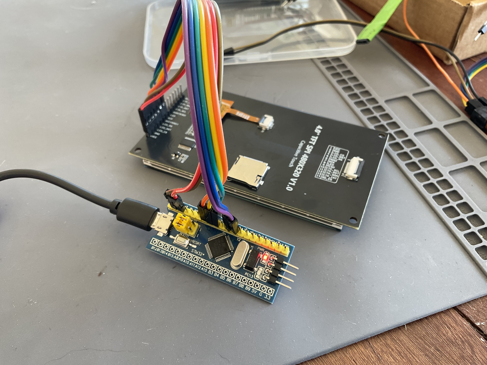
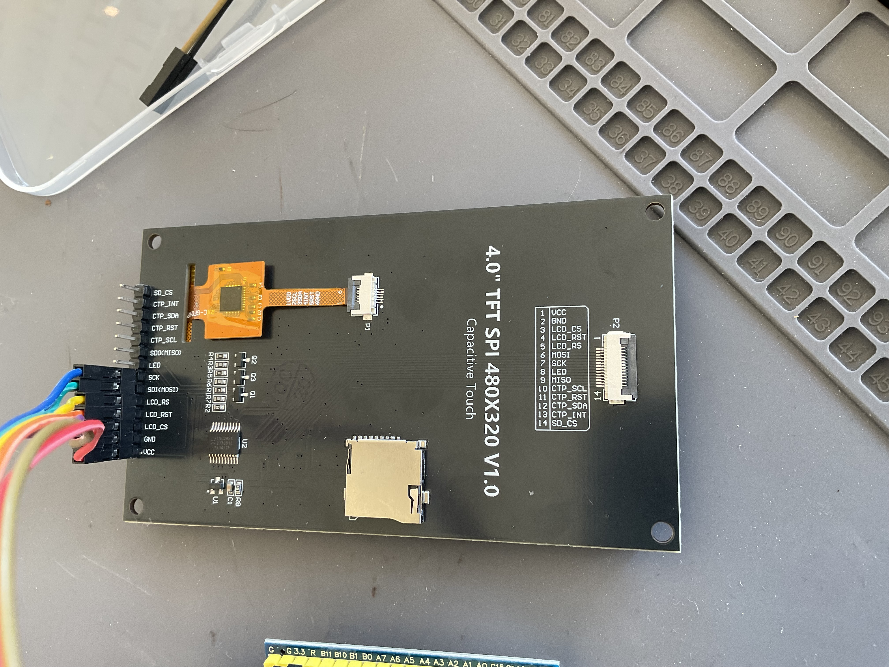
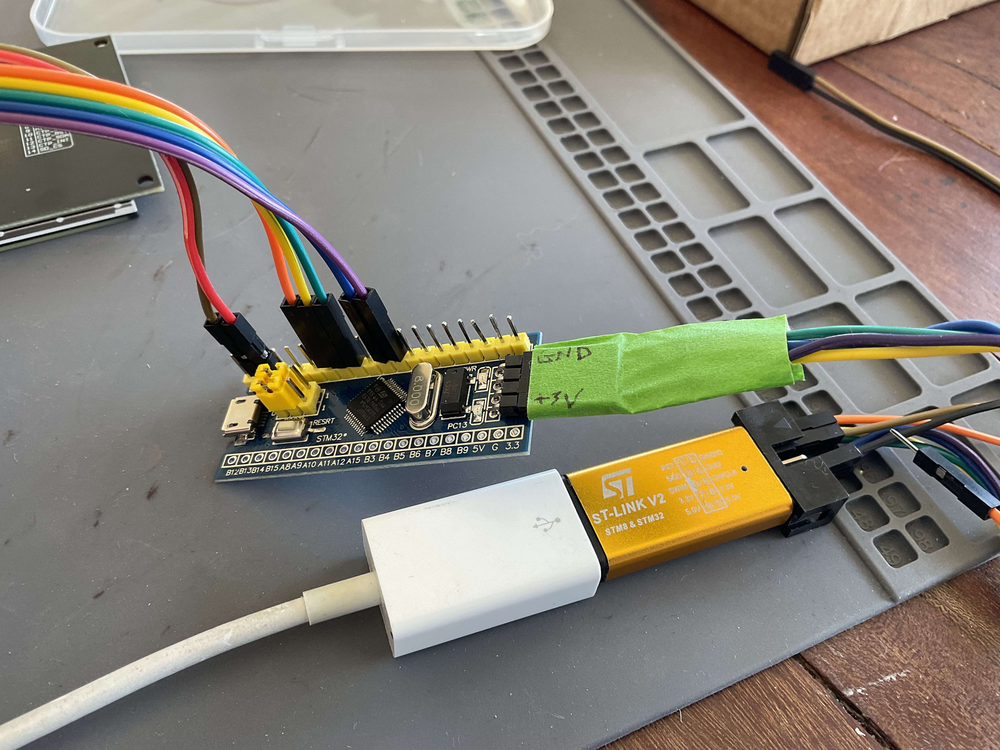
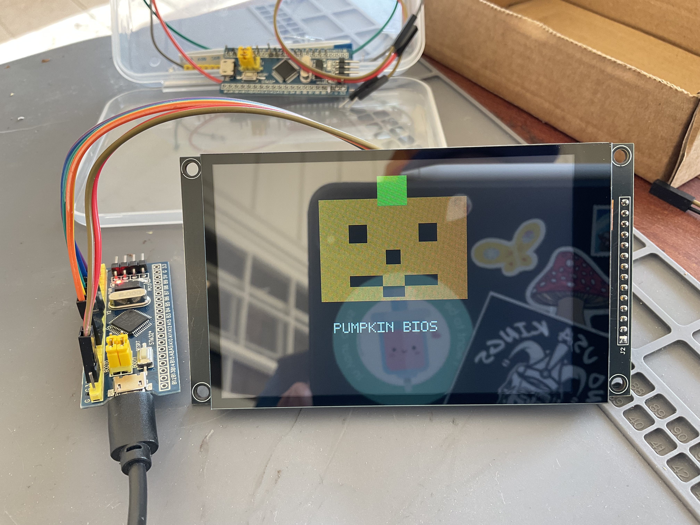
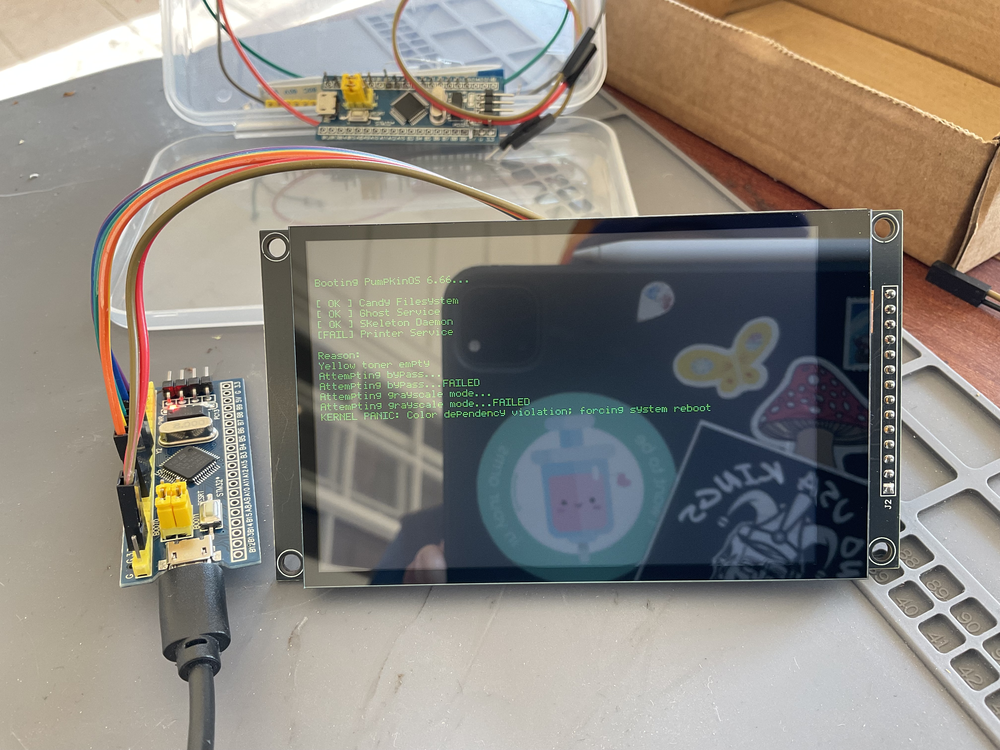
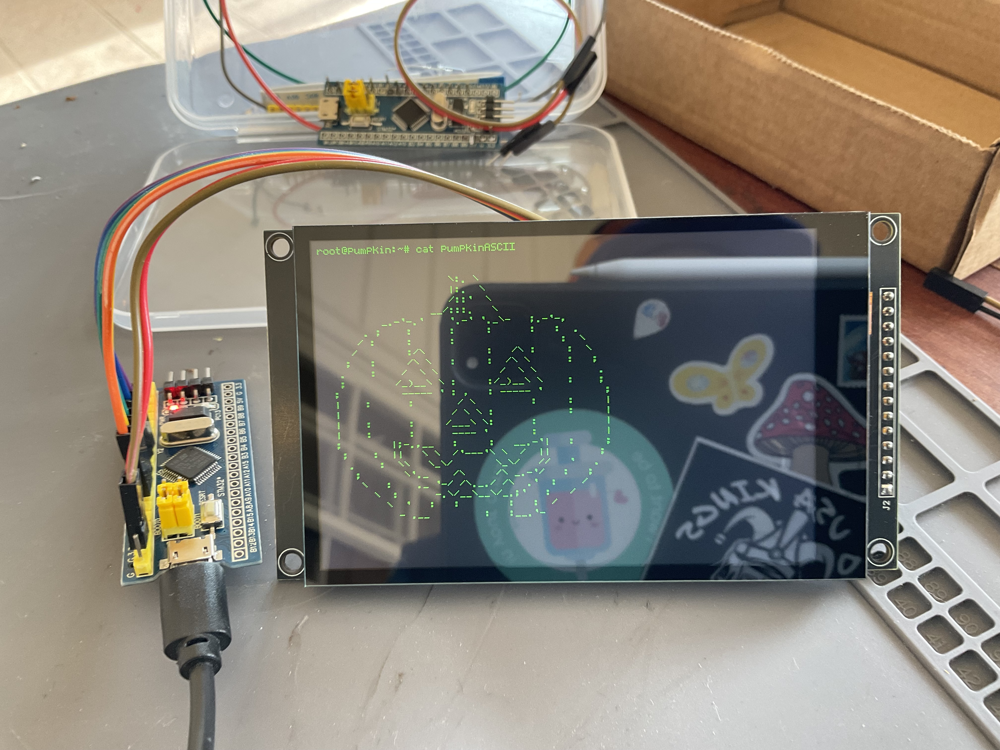

# 🎃 PumpkinOS v0.666

> A completely unnecessary operating system for a pumpkin that does not exist.

PumpkinOS is a Halloween-themed fake operating system running on an STM32 Blue Pill microcontroller and a 4.0-inch ST7796S TFT display.

The project began as a macOS Terminal simulator and eventually escaped onto real embedded hardware. PumpkinOS now includes a custom graphics driver, bitmap font, terminal-style console, randomized typing effects, ASCII art, fake Linux commands, simulated boot failures, scene transitions, and a healthy disrespect for printers.

PumpkinOS serves no practical purpose whatsoever.

**Version 0.666 is the first complete hardware release.**

---

## Screenshots

Hardware:



STM32 Blue Pill + STLink setup:


PUMPKIN BIOS splash screen:


PumpkinOS terminal prompt:


ASCII art scene:


---

## Features

### Display system

- ST7796S TFT display support
- SPI graphics rendering
- 480 × 320 landscape orientation
- Filled rectangles and primitive graphics
- Custom character and text rendering
- Screen-clearing and cursor-management functions

### Custom font engine

- Custom 5 × 7 bitmap glyphs
- Uppercase letters
- Lowercase letters
- Numbers
- Terminal punctuation and symbols
- Scalable character rendering
- Character-by-character drawing

### Terminal console

- Linux-style command prompt
- Automatic line wrapping
- Cursor position tracking
- Automatic screen clearing at the bottom of the display
- Immediate text output with `DisplayText()`
- Typewriter output with `TypeText()`
- Randomized typing delays
- Short, long, and fixed scene delays

### PumpkinOS content

- PUMPKIN BIOS splash screen
- Multi-stage fake boot process
- Simulated boot failures and reboot attempts
- Scene-to-scene execution
- ASCII art
- Fake Linux commands
- Fake networking output
- Printer troubleshooting jokes
- Intentionally questionable system administration

---

## Example output

```text
root@pumpkin:~# test-NetConnection printer0.local -p 8080
bash: test-NetConnection:
command not found

root@pumpkin:~# ping printer0.local
PING printer0 (10.0.0.667)
```

---

## Hardware

The current PumpkinOS build was developed and tested with the following hardware:

- STM32F103C8T6-compatible Blue Pill development board
- 4.0-inch 480 × 320 TFT display using the ST7796S controller
- ST-Link programmer/debugger
- Breadboard or other suitable prototyping arrangement
- Female-to-female or male-to-female jumper wires, depending on the display header
- USB cable or regulated power source
- Soldering equipment, particularly when the display header decides to become a software problem

### Shopping search terms

Compatible-looking hardware can be found by searching common electronics retailers for:

```text
STM32F103C8T6 Blue Pill development board
```

```text
4.0 inch ST7796S 480x320 SPI TFT display
```

```text
ST-Link V2 STM32 programmer
```

> [!IMPORTANT]
> ST7796 display modules are sold in several electrical and pinout configurations. Verify that a display supports SPI communication and inspect its required logic and power voltages before connecting it to the STM32.

---

## Wiring

PumpkinOS communicates with the display through SPI.

The working project uses these STM32 SPI signals:

| STM32 signal | Display signal | Purpose |
|---|---|---|
| PA5 / SPI1_SCK | SCK or CLK | SPI clock |
| PA7 / SPI1_MOSI | SDI, MOSI, or DIN | Display data |
| Configured GPIO | CS | Chip select |
| Configured GPIO | DC or RS | Data/command selection |
| Configured GPIO | RST or RESET | Display reset |
| GND | GND | Common ground |

The exact `CS`, `DC`, and `RESET` pins depend on the GPIO assignments in the STM32CubeMX project configuration. Check the included `.ioc` file and `main.h` before wiring a new build.

> [!CAUTION]
> Do not assume that every display pin marked `VCC` should connect directly to the STM32 3.3 V rail. Display boards differ in regulator, backlight, and logic-level design. Confirm the specifications for the particular module being used.

---

## Software requirements

### Required

The PumpkinOS source code can be opened, built, and flashed using:

- STM32CubeIDE
- Git

For most users, STM32CubeIDE is all that is required. Simply clone the repository, open the project, build, and flash the firmware to a compatible STM32F103C6T6A board.

### Starting From Scratch

If you want to learn how PumpkinOS was created from a blank microcontroller project, you should also install:

- STM32CubeMX
- STM32CubeProgrammer

#### STM32CubeMX

CubeMX was used to:

- Select the STM32F103C6T6A target MCU
- Configure SPI1 for the ST7796 display
- Assign GPIO pins for LCD_CS, LCD_RS, and LCD_RST
- Generate the project scaffolding used by STM32CubeIDE

One lesson learned during development is that the project should be generated directly for **STM32CubeIDE**. Generating code for an alternative IDE/toolchain and later changing targets can create project-import problems and missing build configuration files.

#### STM32CubeProgrammer

CubeProgrammer became an essential troubleshooting tool during hardware bring-up.

During development, situations occurred where:
- STM32CubeIDE debugging sessions became unreliable
- The ST-Link debugger appeared to lose communication with the target
- Manual verification of flash contents was required

CubeProgrammer was used to:

- Verify successful MCU detection
- Read device information
- Erase flash memory
- Program firmware images directly
- Verify flash contents after programming
- Recover boards that initially appeared to be unresponsive

For anyone learning STM32 development, CubeProgrammer is highly recommended even if STM32CubeIDE is used for day-to-day development.

### Development Environment Used

PumpkinOS v0.666 was developed using:

- Apple macOS (M1 OS27), Terminal, micro
- Microsoft Copilot
- STM32CubeIDE
- STM32CubeMX
- STM32CubeProgrammer
- ST-Link V2
- STM32F103C6T6A ("Blue Pill")
- ST7796S 4.0" 480x320 SPI TFT Display

The repository contains the STM32CubeIDE project and the custom PumpkinOS source files.

---

## Building PumpkinOS

1. Clone or download this repository.
2. Open STM32CubeIDE.
3. Import the repository as an existing STM32CubeIDE project.
4. Open the included `.ioc` file and confirm the clock, SPI, and GPIO configuration.
5. Build the project.
6. Connect the STM32 through an ST-Link programmer.
7. Flash the firmware.
8. Watch a tiny pumpkin-themed computer make really terrible jokes.

If the display remains white, verify the following before rewriting the entire driver:

- Display power
- Shared ground
- SPI clock activity
- MOSI/SDI activity
- CS, DC, and RESET connections
- Header solder joints (don't ask me how I know this)

---

## Project structure

The project is separated into several layers:

```text
Core/
├── Inc/
│   ├── pumpkin_console.h
│   ├── pumpkin_os.h
│   └── st7796.h
└── Src/
    ├── main.c
    ├── pumpkin_console.c
    ├── pumpkin_os.c
    └── st7796.c
```

### `main.c`

Initializes the STM32 hardware, display, and PumpkinOS execution.

### `st7796.c`

Contains the low-level display driver, drawing primitives, bitmap glyph table, and character-rendering functions.

### `pumpkin_console.c`

Provides cursor management, text wrapping, prompt rendering, screen clearing, standard text output, and randomized typewriter output.

### `pumpkin_os.c`

Contains the boot sequence, scenes, jokes, ASCII art, transitions, and other poor operating-system decisions.

---

## Development history

PumpkinOS began as a macOS Terminal program with timed text, simulated commands, ASCII art, and scene transitions.

The experience was then ported to an STM32F103 board. The embedded version required:

- ST7796S display initialization
- SPI troubleshooting
- Landscape rotation
- Custom drawing primitives
- A complete bitmap character system
- Uppercase, lowercase, number, and punctuation glyphs
- Cursor and console management
- Automatic line wrapping
- Randomized typewriter timing
- Scene conversion from terminal output to display rendering

One of the longest display-debugging sessions was eventually traced to a poor solder connection on the MOSI/SDI display header.

Several hours of software debugging were resolved with a soldering iron.

As is tradition.

### Hardware Status Indicators

PumpkinOS includes two diagnostic LEDs:

- **PC13** - Undead heartbeat monitor
  - Blinking: Brain activity detected.
  - Not blinking: Brain may have been eaten.

- **PB4** - Disk activity simulator
  - Random bursts indicate critical background tasks such as:
    - Ghost indexing
    - Printer diagnostics
    - Skeleton database maintenance
    - Dad joke compilation

Both indicators are completely decorative and should not be interpreted as evidence of actual productivity.

---

## Current status

PumpkinOS v0.666 successfully provides:

- A working STM32 hardware implementation
- Stable ST7796S display output
- 480 × 320 landscape graphics
- A custom bitmap font
- A functional terminal-style console
- Randomized typewriter output
- Automatic text wrapping
- Multiple animated scenes
- ASCII art rendering
- Fake boot and reboot sequences
- A complete start-to-finish PumpkinOS demonstration

---

## Future ideas

Possible future additions include:

- True terminal scrolling
- Interactive command input
- Physical buttons or keyboard input
- Sound effects
- SD card support
- Additional animation
- More scenes
- More ASCII art
- Network connectivity
- Additional printer jokes
- Save files nobody asked for
- A shutdown process that does not inspire confidence

---

## Version history

### v0.666

First complete hardware release.

Major milestones:

- ST7796S display bring-up completed
- Bad MOSI/SDI solder connection identified and repaired
- Stable SPI communication achieved
- Display rotated into landscape mode
- Custom bitmap font completed
- Console subsystem implemented
- Typewriter output implemented
- ASCII art rendering implemented
- Scene architecture ported from macOS to STM32
- Full PumpkinOS sequence running on physical hardware

---

## License

PumpkinOS is released under the MIT License.

You are free to use, copy, modify, merge, publish, distribute, sublicense, and sell copies of the software, provided that the original copyright notice and license are included.

See the LICENSE file for the complete license text.

Copyright © 2026 Christopher Hoover

---

## Final warning

PumpkinOS is experimental Halloween firmware.

It is not a real operating system.

It should not be used for critical infrastructure, medical equipment, aviation, nuclear control systems, production print servers, or any device expected to behave sensibly.

Especially production print servers. ;)
